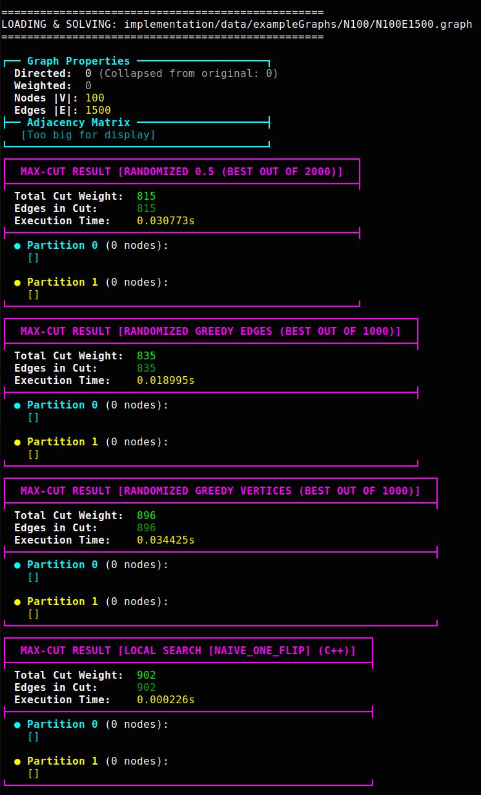
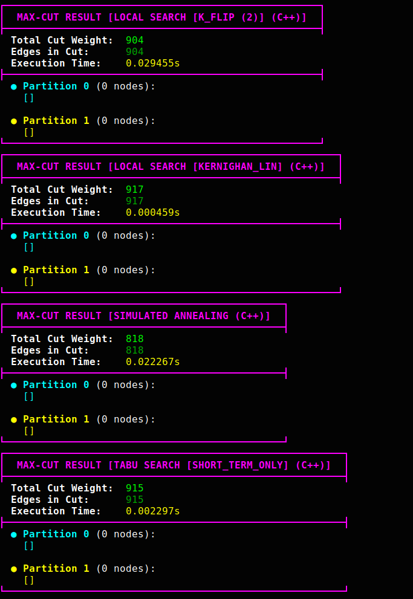
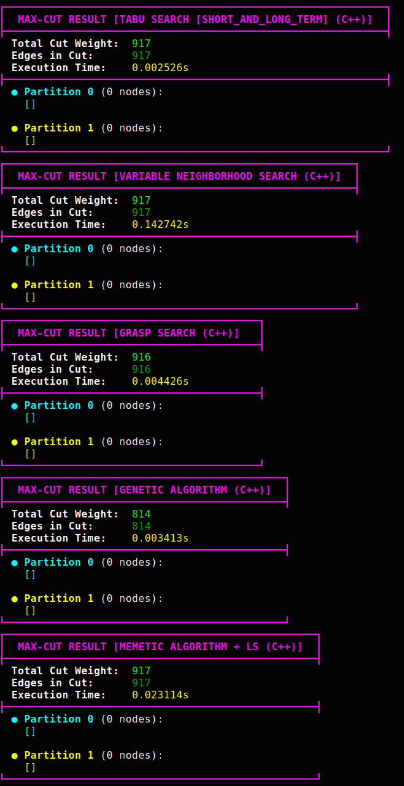
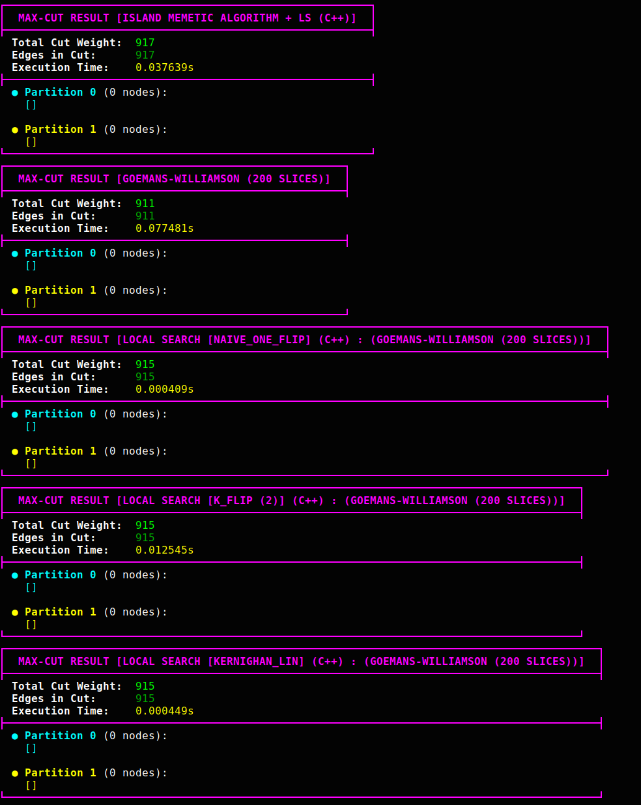
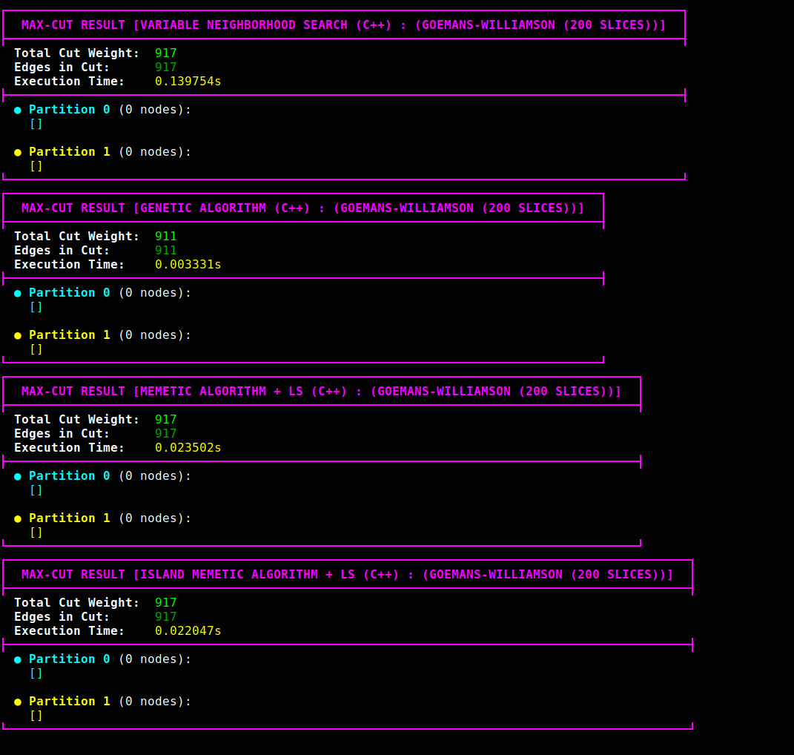
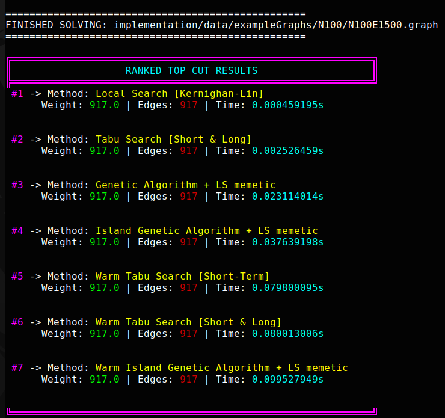

# Methodology

`This repository consists of documented details of the computational and mathematical frameworks as well as the implementation of them for solving the **Max-Cut problem** across exact mathematical programming, theoretical approximations, classical metaheuristics, and quantum computing paradigms.`

> be informed that this readme.md also serves a purpose of WIP notebook for all the stuff that will need to be cited or improved (when it comes to explanation) -> therefore it might feel a bit disorganized or confusing to read in some places

**Implementation overview:** The exact, SDP-based and quantum solvers are written in Python (Gurobi / python-MIP, MOSEK, Qiskit). Randomized approximations, local searches and metaheuristics are written in C++ with OpenMP parallelism and share a common `CutState` structure that maintains the partition, cut weight, cut edge count and the O(1)-queryable gain of flipping a single vertex (`flip_delta`). All solvers return the partition, cut weight, cut edge count and execution time. All C++ library have been provided with Python interface that allows usage of common `Result` and `Graph` Python classes with various QOL features like interactive graph presentation, tidy terminal display etc.

---

## Exact Methods (Binary-Integer Programming)

Exact methods formulate Max-Cut as a **Binary Integer Program (BIP)** with a linearized objective, guaranteeing global optimality through **Gurobi** (Branch-and-Bound, cutting planes, presolving).

- **Default BIP Formulation** (`solve`, built with python-MIP using the Gurobi backend)
  - **General idea:** Define a binary vertex variable $v_i \in \{0, 1\}$ (partition side) for each vertex and a binary edge variable $e_{ij}$ for each edge with non-zero weight (only the upper triangle of the weight matrix is iterated). The objective maximizes $\sum_{(i,j) \in E} w_{ij} e_{ij}$.
  - **Linearization:** The quadratic term $w_{ij}(v_i + v_j - 2 v_i v_j)$ is replaced by the edge variable together with two upper-bounding constraints:
    - $e_{ij} \le v_i + v_j$ (an edge can only be cut if at least one endpoint is on side 1)
    - $e_{ij} \le 2 - (v_i + v_j)$ (an edge can only be cut if at least one endpoint is on side 0)
  - **Implementation details:** No additional valid inequalities (e.g. triangle/odd-cycle cuts) are added explicitly; strengthening of the LP relaxation is left to Gurobi's internal cut generation and presolve. If no feasible solution is found, an empty result is returned.
  - **Potential Key References / Publications:** *[Cite foundational MIP literature and Gurobi optimization manuals, e.g., Achterberg, 2007]*

- **Native Gurobi Implementation with Incumbent Callbacks** (`solve_with_partial_results`)
  - **General idea:** Rebuild the same model with the native `gurobipy` API to gain access to Gurobi's solver callbacks. The callback monitors the branch-and-bound search (it does **not** inject lazy constraints) and reports the best known solution live as the solver progresses.
  - **Implementation details:**
    - On every new incumbent (`MIPSOL`) the partition is extracted and its **true cut weight is recomputed from the partition** rather than read from the model objective, since the edge variables are only upper-bounded and can undercount.
    - Periodic `MIP` callbacks catch best-bound improvements that occur without a new incumbent.
    - The relative MIP gap between the best incumbent and the best bound is computed on each change. Results are reported either on every change, or only when the gap crosses user-defined thresholds (e.g. 15%, 12%, 9%, 6%, 3%, 1%) through an `on_checkpoint` callback.
    - An optional time limit is supported; if it is hit, the best incumbent and the final MIP gap are reported as one last checkpoint.
    - Returns `None` if `gurobipy` is not installed.
  - **Potential Key References / Publications:** *[Cite Gurobi callback documentation and literature on anytime / gap-based reporting for MIP solvers]*

---

## Approximation Algorithms

Approximation algorithms offer polynomial-time solvability coupled with worst-case (or expected) performance guarantees relative to the global optimum.

- **Goemans-Williamson Algorithm**
  - **General idea:** Implement the classic 0.878-approximation (in expectation, for non-negative weights) by relaxing the quadratic formulation into a Semidefinite Program (SDP), solving it with interior-point methods, and rounding the resulting unit vectors into binary assignments using random hyperplanes.
  - **SDP formulation:** Maximize $\tfrac{1}{4}\sum_{i,j} W_{ij}(1 - X_{ij})$ over a symmetric positive semidefinite matrix $X$ subject to $X_{ii} = 1$. The current implementation calls the **MOSEK Fusion API** directly (for lower RAM usage); an earlier CVXPY + MOSEK implementation is kept as a legacy reference.
  - **Rounding:**
    - The solution matrix is regularized by clipping its eigenvalues to a small positive floor ($10^{-9}$) and reconstructing it, then factorized by Cholesky decomposition to obtain the vectors $v_i$.
    - A configurable number of random Gaussian hyperplanes (`RANDOM_SLICE_TRIALS`) are drawn and normalized (vectorized as a single matrix product). Each vertex is assigned by the sign of $\langle v_i, r \rangle$.
    - Each resulting cut is evaluated and the **best of all slices** is returned.
  - **Potential Key References / Publications:** *[Cite Goemans & Williamson, 1995]*

- **Randomized Combinatorial Approximations** (C++, best-of-`trials`)
  These are SDP-free randomized baselines. Each runs for a fixed number of trials and keeps the best cut found.
  - *Randomized Half:* Each vertex is independently placed on either side with probability 1/2 (a uniform random partition). In expectation this cuts half of the total edge weight (a 0.5-approximation for non-negative weights).
  - *Randomized Greedy Edges:* Edges are shuffled in random order and processed sequentially. An edge with both endpoints unassigned places them on opposite sides (random orientation); an edge with one assigned endpoint places the other endpoint on the opposite side; already-assigned edges are skipped. Vertices left unassigned are placed randomly.
  - *Randomized Greedy Vertices:* Start from a random partition and visit the vertices in a random order. A vertex is flipped when the weight of its edges to vertices on its own side exceeds the weight of its edges crossing the cut (i.e. a single randomized pass of 1-flip improvement using neighbor weights from the adjacency list).
  - **Potential Key References / Publications:** *[Cite literature on randomized and greedy Max-Cut approximations, e.g., Sahni & Gonzalez, 1976]*

---

## Classical Heuristics & Metaheuristics

For large-scale graph instances where exact MIP solvers and SDP approximations become computationally expensive, metaheuristics provide an effective trade-off between solution quality and execution time. All of them operate on partition vectors and use the incremental `flip_delta` gain of a single-vertex flip. These methods might take advantage of a `warm-start` - i.e. running algorithm on already predetermined, guarranteed approximation, for instance - *Goemans-Williamson* approximated output becomes *Local Search*'s initial state.

- **Local Search Strategies**
  - **Naive 1-Flip (Steepest Ascent):** Repeatedly flips the single vertex with the largest positive gain until no improving flip exists.
  - **K-Flip Local Search:** First exhausts best-improvement 1-flips. When none remain, it exhaustively enumerates combinations of 2 up to $K$ vertices (depth-first over increasing vertex indices), parallelized with OpenMP with thread-local state copies. The best improving combination found is applied, and the search returns to the 1-flip phase; it terminates when no improving combination of size up to $K$ exists.
  - **Kernighan-Lin / Fiduccia–Mattheyses Inspired Variable-Depth Pass:** In each pass, all vertices start unlocked. At every step the unlocked vertex with the highest gain (even if negative) is flipped and locked, building a sequence of interdependent moves. The pass is then rolled back to the prefix with the best cumulative cut weight; passes are repeated until a pass yields no improvement. Vertex selection is a linear scan (no gain buckets) and, unlike classic graph partitioning, no balance constraint is imposed.
  - **Potential Key References / Publications:** *[Cite Kernighan & Lin, 1970; Fiduccia & Mattheyses, 1982]*

- **Variable Neighborhood Search (VNS)**
  - **General idea:** Start from a random (or supplied) partition refined by Kernighan-Lin local search. At each iteration, for neighborhood size $k = 1, \dots, k_{max}$: *shake* a copy of the incumbent by flipping $k$ distinct random vertices (an O(k) perturbation using a hash set with linear probing), then re-optimize with Kernighan-Lin local search. If the result improves on the best cut found, it becomes the new incumbent and $k$ resets to 1; otherwise $k$ is incremented.
  - **Potential Key References / Publications:** *[Cite Mladenović & Hansen, 1997]*

- **Greedy Randomized Adaptive Search Procedure (GRASP)**
  - **General idea:** Multi-start metaheuristic. Each iteration (1) constructs a partition vertex by vertex: a random first vertex is placed, then at each step the gains of all unassigned vertices are computed, a Restricted Candidate List (RCL) is formed from vertices whose gain is within $\alpha \cdot (\text{max} - \text{min})$ of the best gain, and one RCL member is chosen at random and assigned to a side according to the sign of its gain; then (2) improves the constructed partition with Kernighan-Lin local search. The parameter $\alpha$ controls greediness (0 = purely greedy, 1 = purely random).
  - **Parallelization:** Iterations are distributed dynamically across OpenMP threads, each with its own random number generator and thread-local best; thread-local bests are merged in a critical section.
  - **Potential Key References / Publications:** *[Cite Feo & Resende, 1995]*

- **Simulated Annealing**
  - **General idea:** Probabilistic metaheuristic modeling thermodynamic annealing. At each step a random vertex is selected and its flip gain $\Delta$ evaluated; improving moves are always accepted, while cut-decreasing moves are accepted with the Metropolis probability $e^{\Delta / T}$.
  - **Schedule:** $n$ moves are performed per temperature level; the number of temperature levels is `max_iterations / n` (at least 1); the temperature is multiplied by a geometric `cooling_rate` after each level, and the run stops early if $T < 10^{-12}$. The best partition is copied only when a new global best is found.
  - **Potential Key References / Publications:** *[Cite Kirkpatrick et al., 1983]*

- **Tabu Search**
  - **Move selection:** At every iteration, all vertices are scanned and the best-scoring non-tabu flip is applied, even when it worsens the cut. If all moves are tabu and none satisfies the aspiration criterion, the move with the maximum raw gain is chosen as a fallback.
  - **Short-Term Memory:** A recency-based tabu list stores, for each vertex, the iteration until which it cannot be flipped again (`tabu_tenure`). An **aspiration criterion** overrides tabu status if the move would produce a new global best.
  - **Long-Term Memory (mode `SHORT_AND_LONG_TERM`):** A per-vertex flip-frequency counter penalizes the move score by $0.01 \times \text{frequency}$, steering the search away from frequently flipped vertices (frequency-based diversification). In `SHORT_TERM` mode the penalty is disabled.
  - **Potential Key References / Publications:** *[Cite Glover, 1989, 1990]*

- **Genetic Algorithms (GA)**
  - **Basic GA:** A steady-state evolutionary algorithm over binary partition strings (optionally seeding one individual with a supplied partition). The population is sorted by fitness (total cut weight) each generation; two parents are selected by rank-biased tournament (the better of two uniformly drawn ranks), a single child is produced by **uniform crossover** (each gene taken from either parent with probability 0.5) followed by **bit-flip mutation**, and the child replaces the worst individual if it is fitter.
  - **Memetic Algorithm:** Same steady-state scheme, but every initial individual and every child (after mutation) is refined with Kernighan-Lin local search before competing for a place in the population. Runs sequentially.
  - **Potential Key References / Publications:** *[Cite Goldberg, 1989; Moscato, 1989]*

- **Island Genetic Algorithm (Memetic)**
  - **General idea:** Parallel memetic GA in which each OpenMP thread is one island with its own sub-population (total population divided among islands, minimum 4 individuals each), its own random seed, and access to the full graph. Each island runs the memetic steady-state loop described above.
  - **Migration:** Every `migration_interval` generations, islands synchronize at a barrier and each exports its best individual to the next island in a **ring topology**, where it replaces the receiving island's worst individual. This maintains diversity and mitigates premature convergence.
  - **Result:** The best individual across all islands is returned.
  - **Potential Key References / Publications:** *[Cite Whitley et al., 1999]*

---

## Quantum Approaches

Exploration of quantum computing paradigms to assess the scalability of hybrid quantum-classical approaches to the Max-Cut problem. Quantum Annealing was also considered as a potential approach but ultimately excluded due to the unavailability of a D-Wave license.

- **Quantum Approximate Optimization Algorithm (QAOA)**
  - **General idea:** Express Max-Cut as a scoring function over all $2^n$ partitions, the cost Hamiltonian $H_C = \frac{1}{2}\sum_{(i,j) \in E} w_{ij}(I - Z_i Z_j)$, which is a diagonal table whose entry for each partition is its cut weight. QAOA keeps one complex amplitude per partition, starting uniform (Hadamards on all qubits) so every partition is equally likely. A partition is finally sampled with probability equal to the squared magnitude of its amplitude, and the circuit is built so that high-cut partitions end up with large amplitudes.
  - **Circuit structure:** The circuit consists of $p$ layers, each with its own pair of angles $(\gamma_k, \beta_k)$:
    - *Cost step* $e^{-i\gamma_k H_C}$: multiplies each partition's amplitude by a phase proportional to its cut weight. Since the cut weight is a sum over edges, this factors into one `RZZ(-γ_k·w_ij)` (double qubit) gate per edge, which multiplies each amplitude by a number depending only on whether that edge is cut (equal to the cost evolution up to a global phase). It changes phases only, not probabilities.
    - *Mixer step* $e^{-i\beta_k H_B}$ with $H_B = \sum_i X_i$: blends each partition's amplitude with those of the partitions differing in exactly one vertex, implemented as one `RX(2β_k)` (single qubit) gate per qubit. Because amplitudes are added, the phases from the cost step decide whether they reinforce or cancel, which shifts probability toward high-cut partitions.
  - **Classical angle optimization:** The $2p$ angles $(\gamma, \beta)$ are tuned with **COBYLA** against the **exact expectation value** computed by a custom NumPy statevector simulation (diagonal cost operator plus in-place mixer application, complex64), with several random restarts (`N_RESTARTS`, `MAX_ITER` iterations each). Because the exact expectation is used, optimization is free of shot noise, but it limits the instance size (default maximum of 24 qubits).
  - **Sampling / execution environments** (the optimized circuit is sampled once with `SHOTS` shots; the best bitstring over all shots is returned, and the mean cut over all shots is recorded for comparison with a random baseline):
    - *AerSimulator:* Noise-free sampling of the transpiled circuit on Qiskit Aer (no noise model is injected in the current implementation).
    - *Real QPU:* Single-job execution on an IBM Quantum device through Qiskit Runtime (`SamplerV2`), either a named backend or the least busy operational device with enough qubits. The circuit is transpiled to the device topology and native gate set with the preset pass manager (optimization level 3); the job id is printed so results can be retrieved later. No custom error-mitigation settings are configured beyond Runtime defaults.
  - **Validation and diagnostics utilities:**
    - *Circuit verification:* compares the Qiskit circuit's expected cut with the NumPy simulation on a small graph to confirm both implement the same unitary.
    - *Reference values:* computes the exact optimum by brute force over all $2^n$ bitstrings, plus the best and mean cut of random sampling with the same number of shots.
    - *Transpile report:* transpiles for a chosen backend (costing no QPU time) and reports circuit depth and two-qubit gate count.
  - **Potential Key References / Publications:** *[Cite Farhi, Goldstone, & Gutmann, 2014]*

### Small presentation of the results:

 
