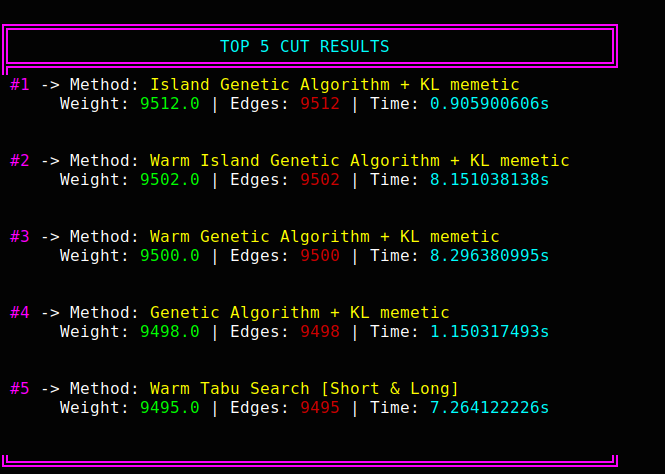

## Overview of different approaches:

### Meta-Heuristics and Memetics:
  - QAOA
    - simulated
    - IBM `QPU`

  - GRASP

  - VNS

  - Local Search:
    - Naive
    - K'flip
    - variable depth pass (KL/FM inspired)

  - Tabu Search
    - short memory
    - long and short memory

  - Genetic
    - default (uniform crossover)
    - memetic (with local improvement)

  - Genetic Island
    - default (uniform crossover)
    - memetic (with local improvement)

### Approximations:
  - Goemans–Williamson algorithm

  - Randomized half

  - Randomized greedy edges

  - Randomized greedy vertices

### Exact solutions (solvers):
  - BIP formulation solvers - Gurobi
    - Available callbacks

### Small presentation:

 
